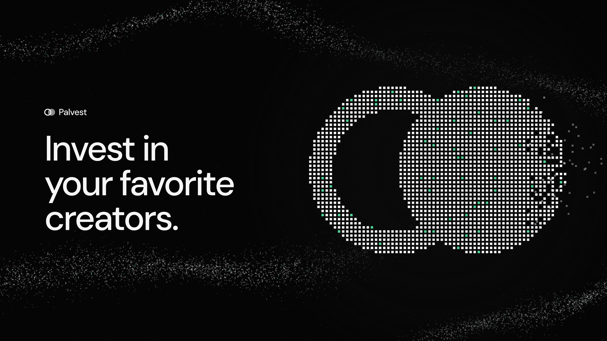
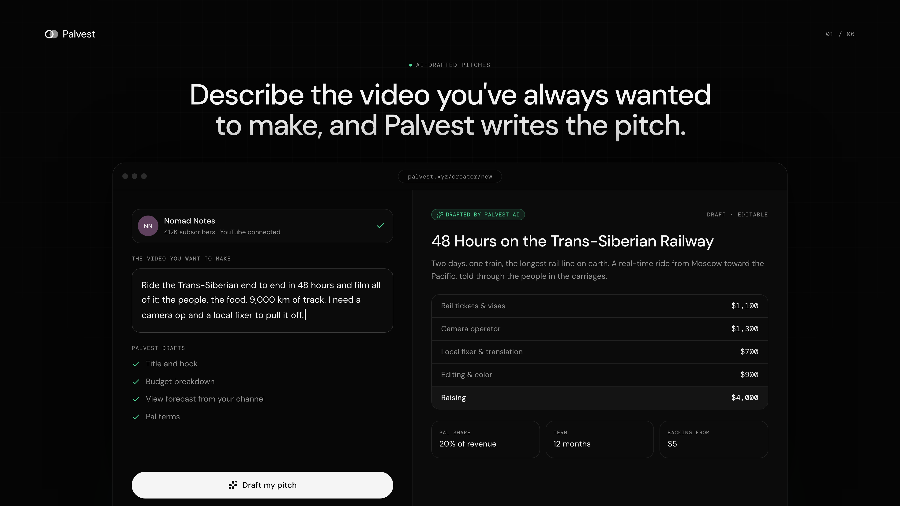
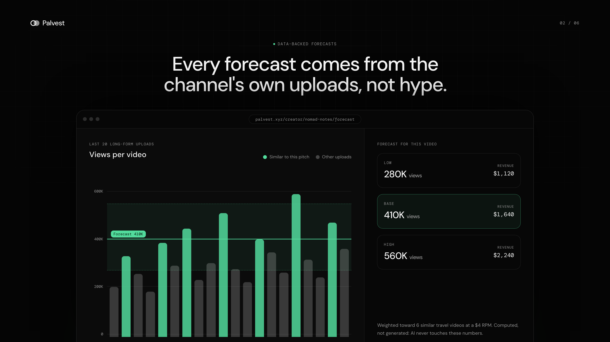
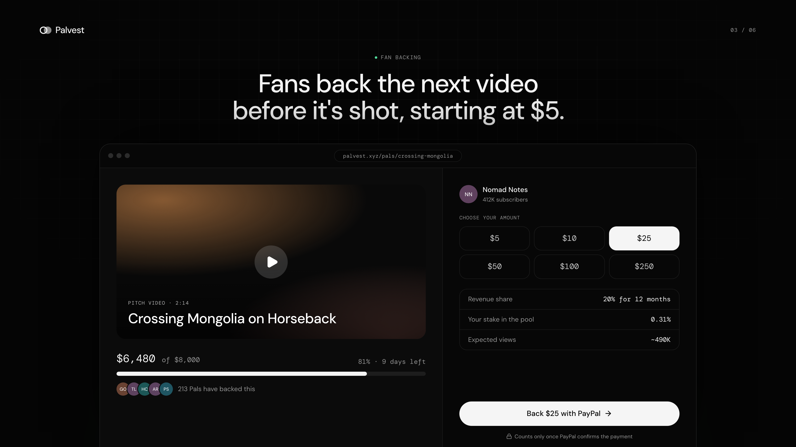
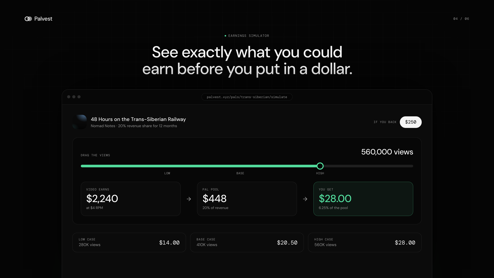
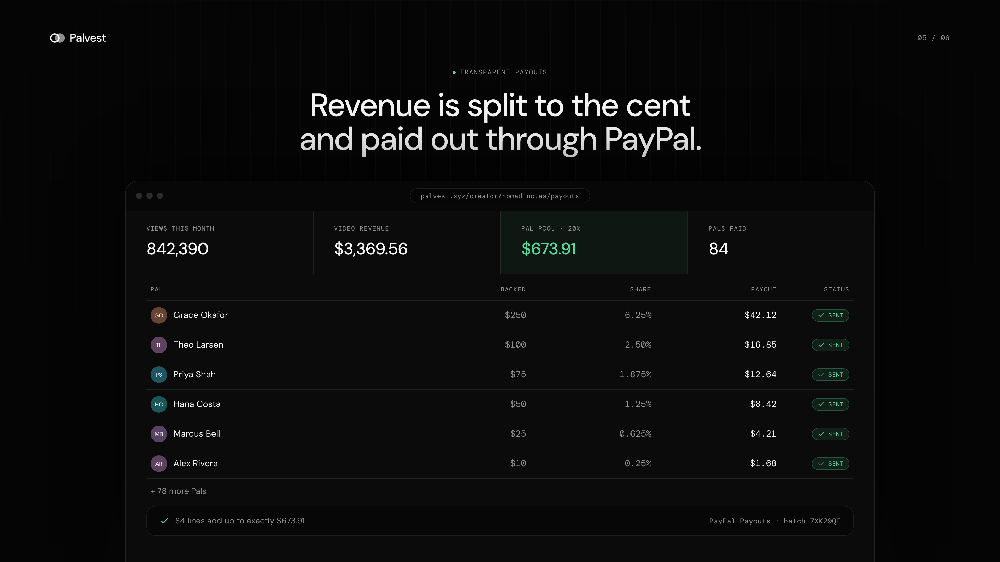
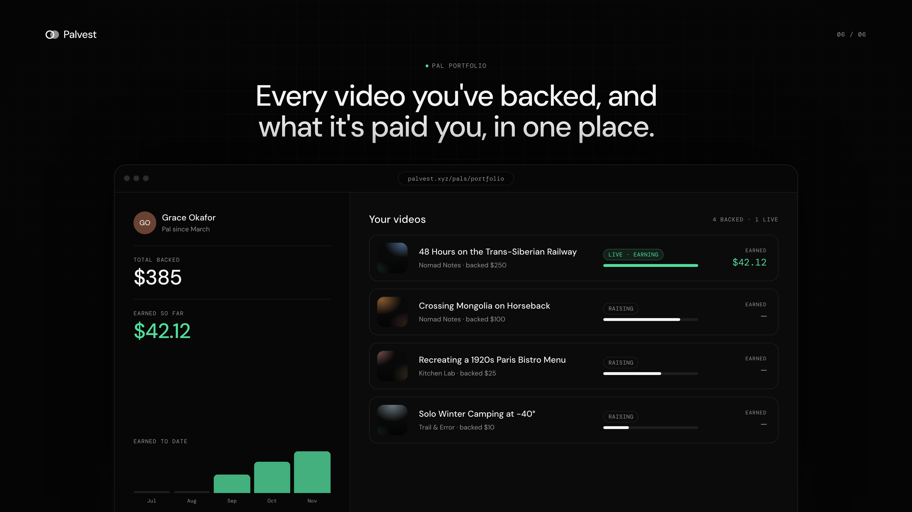

# Palvest

**Invest in your favorite creators.** Fans back a YouTube creator's next video before it's made, and get a share of what it earns.



**Live demo:** [www.palvest.xyz](https://www.palvest.xyz) · **License:** [MIT](LICENSE)

## What it does

A creator describes a video they want to make. Palvest drafts the pitch with AI and forecasts its views from the channel's real YouTube data. Fans ("Pals") back it through PayPal, from $5. Once the video is live, the creator pays a fixed share of its revenue into a pool, and Palvest splits that pool to the cent and pays every Pal through PayPal Payouts.

| | |
|---|---|
|  |  |
|  |  |
|  |  |

## How we used PayPal

PayPal moves all the money in both directions. Everything runs against the **PayPal Sandbox** REST APIs, with code in [`src/lib/paypal.ts`](src/lib/paypal.ts) and [`src/lib/payouts.ts`](src/lib/payouts.ts).

| Step | PayPal API | What happens |
|---|---|---|
| Authenticate | OAuth 2.0 `/v1/oauth2/token` | The server exchanges the client ID and secret for an access token. Secrets never reach the browser. |
| A fan backs a video | **Orders v2** `POST /v2/checkout/orders` (`intent: CAPTURE`) | The server creates the order and a *pending* backing. The **PayPal JS SDK** (`@paypal/react-paypal-js`) shows the checkout buttons; if the popup can't load, a redirect checkout uses the same endpoints. |
| Confirm the backing | **Orders v2** `POST /v2/checkout/orders/{id}/capture` | A backing only counts once PayPal reports `COMPLETED` for the expected amount and project. Capture is idempotent (`PayPal-Request-Id`), so retries and double clicks are safe. |
| Creator funds the Pal pool | **Orders v2** create + capture | When the video earns, the creator pays the Pals' share in through PayPal. The capture must match the pool amount and distribution ID exactly. |
| Pay every Pal | **Payouts v1** `POST /v1/payments/payouts` | One batch, one item per Pal. Before sending, Palvest writes a ledger, split pro rata in whole cents with the largest-remainder method, so the lines add up exactly to the pool. |
| Track payouts | **Payouts v1** `GET /v1/payments/payouts/{batch_id}` | *Refresh status* pulls batch and item statuses back into the ledger. |

## How we used AI

AI writes the pitch; it never produces the numbers.

- **Model:** Anthropic **Claude** (`claude-opus-5-5`) via the official `@anthropic-ai/sdk`, in [`src/lib/ai.ts`](src/lib/ai.ts).
- **What it does:** from the creator's one-paragraph idea and their channel's recent uploads, Claude drafts an editable proposal (title, description, budget breakdown, funding target, and a suggested revenue share and term) and picks 2–6 past uploads most similar to the new idea.
- **Structured outputs:** the response is constrained to a Zod schema (`output_config.format`), so the app always gets valid, typed JSON. Server-side checks then drop any video ID Claude invents, make the budget lines add up to the target, and clamp the share to 5–50% and the term to 3–36 months.
- **Safety:** low effort for speed, server-side model fallbacks, and explicit handling of refusals and incomplete responses with a clear error for the creator.
- **Deterministic forecast:** views and revenue come from plain code in [`src/lib/finance.ts`](src/lib/finance.ts). Low, base and high are the 25th percentile, median and 75th percentile views of the channel's last 20 mature long-form uploads. When Claude picked similar videos, the base is weighted 65% toward them. Revenue = views ÷ 1000 × RPM.

## Tech stack and tools

| Area | Tools |
|---|---|
| App | Next.js 16 (App Router, Cache Components, Turbopack), React 19, TypeScript |
| UI | Tailwind CSS v4, shadcn/ui + Radix, Recharts, lucide icons, DM Sans / DM Mono |
| Payments (sponsor) | **PayPal** Orders v2, Payouts v1, JS SDK (Sandbox) |
| AI | **Anthropic Claude** API with structured outputs |
| Data | **YouTube Data API v3** for public channel and video statistics |
| Database | **Supabase** Postgres via the `postgres` driver |
| Validation | Zod for API inputs and AI output schemas |
| Hosting | **Vercel** |

## Setup

**Requires:** Node.js 20+, pnpm 10, a Postgres database, and API keys for PayPal Sandbox, YouTube and Anthropic.

```bash
git clone https://github.com/charmxyz/palvest.git
cd palvest
pnpm install
cp .env.example .env.local   # then fill in the keys below
pnpm db:setup                # creates the tables and loads demo data
pnpm dev                     # http://localhost:3000
```

### Environment variables

| Variable | Where to get it |
|---|---|
| `DATABASE_URL` | Supabase → Project Settings → Database → Connection string → **Transaction pooler**. Any Postgres works locally. |
| `YOUTUBE_API_KEY` | Google Cloud Console → enable **YouTube Data API v3** → Credentials → API key. |
| `ANTHROPIC_API_KEY` | [console.anthropic.com](https://console.anthropic.com) → API keys. |
| `PAYPAL_CLIENT_ID`, `NEXT_PUBLIC_PAYPAL_CLIENT_ID` | [developer.paypal.com](https://developer.paypal.com) → Apps & Credentials → **Sandbox** → create a REST app. Use the same client ID for both. |
| `PAYPAL_CLIENT_SECRET` | Same Sandbox app. Turn on **Payouts** for the app. |
| `PAYPAL_BASE_URL` | Leave as `https://api-m.sandbox.paypal.com`. |
| `NEXT_PUBLIC_APP_URL` | `http://localhost:3000` locally, your deployment URL in production. |
| `CREATOR_PASSWORD` | Optional shared password for the creator studio. Leave empty to keep it open. |

To pay in checkout, log in with a **Personal** Sandbox account from PayPal Developer → Testing Tools → Sandbox Accounts.

### Deploy

Import the repo into Vercel, add the same environment variables (set `NEXT_PUBLIC_APP_URL` to the deployment URL), deploy, then run `pnpm db:setup` once against the production `DATABASE_URL`.

## Try the demo

1. Open `/creator` and paste a real channel, e.g. `youtube.com/@veritasium`. The channel is analyzed live.
2. **Start proposal**, describe an idea with a budget, and let Claude draft it. Edit anything, then **Publish**.
3. Open the Pal page and back it with a PayPal Sandbox buyer. Funding updates once the capture is confirmed.
4. Switch to **Nomad Notes** → *48 Hours on the Trans-Siberian Railway*: 842,390 views → $3,369.56 revenue → **$673.91** for Pals.
5. **Distribute to Pals**: see the ledger across 84 Pals and the PayPal Payouts batch ID.
6. Visit `/pals/portfolio` as *Alex Rivera* to see the payout arrive.

**Reset demo data** in the creator sidebar restores everything.

More detail on routes, the money flow and the repo layout is in the [developer guide](docs/DEVELOPER_GUIDE.md).

## Disclaimer

Palvest is a hackathon prototype running on PayPal Sandbox; no real money moves. Returns aren't guaranteed, and Pals don't own the video or the creator's company. See the [Terms](https://www.palvest.xyz/terms) and [Privacy Policy](https://www.palvest.xyz/privacy).

## License

[MIT](LICENSE)
