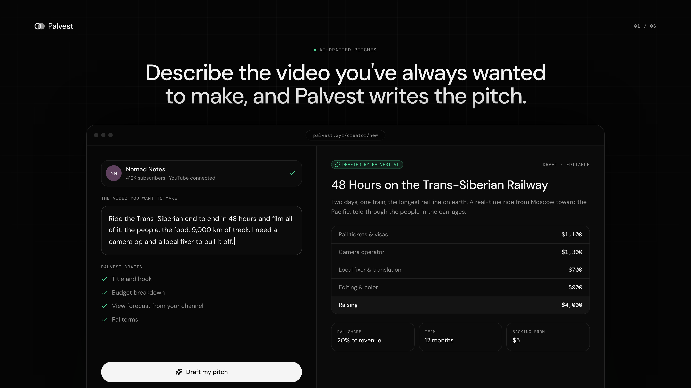
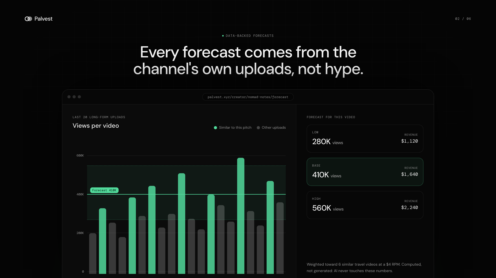
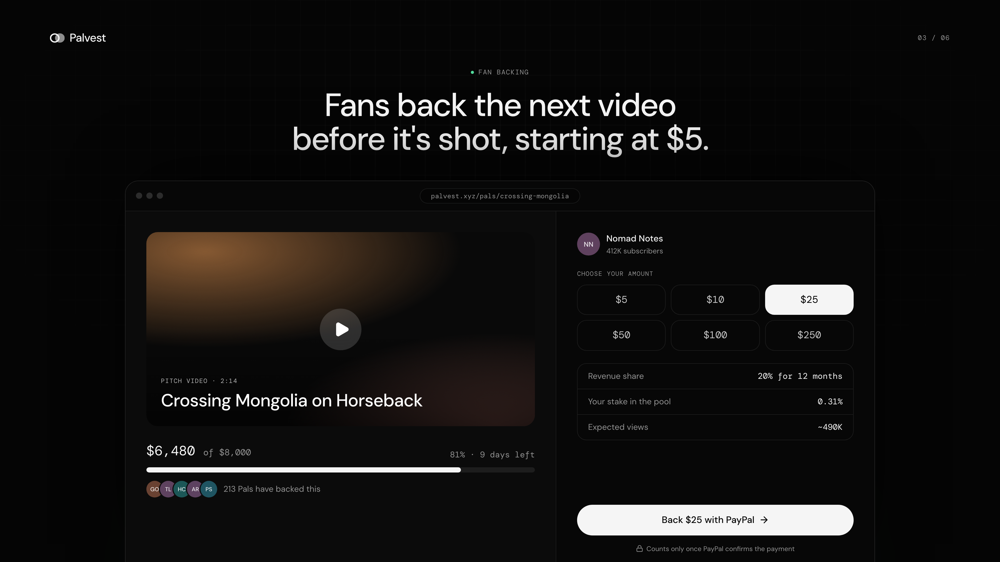
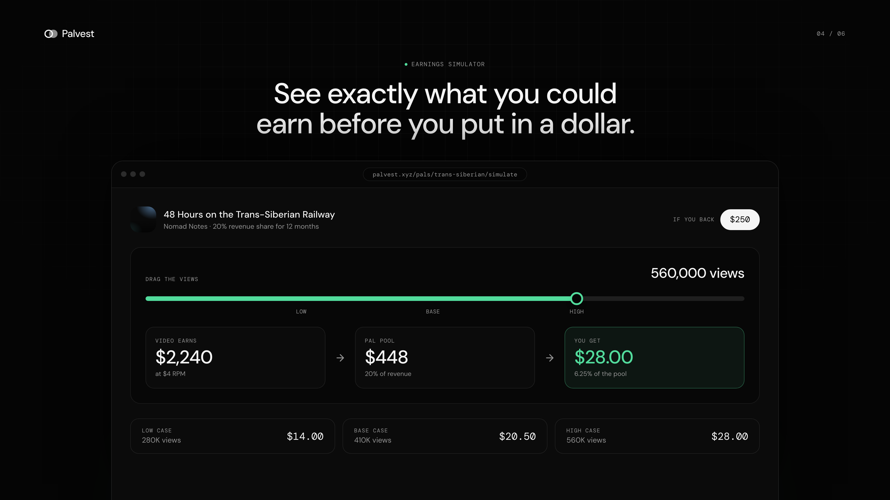
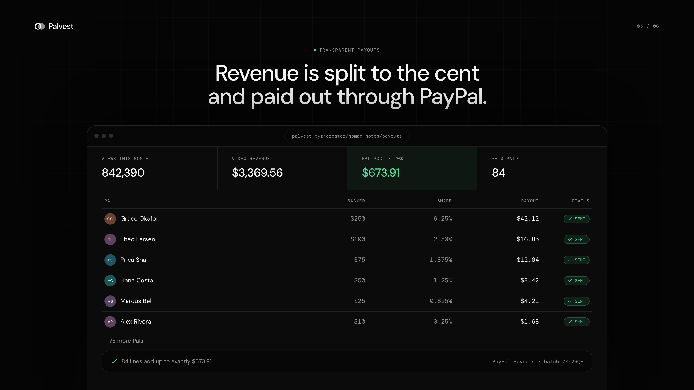
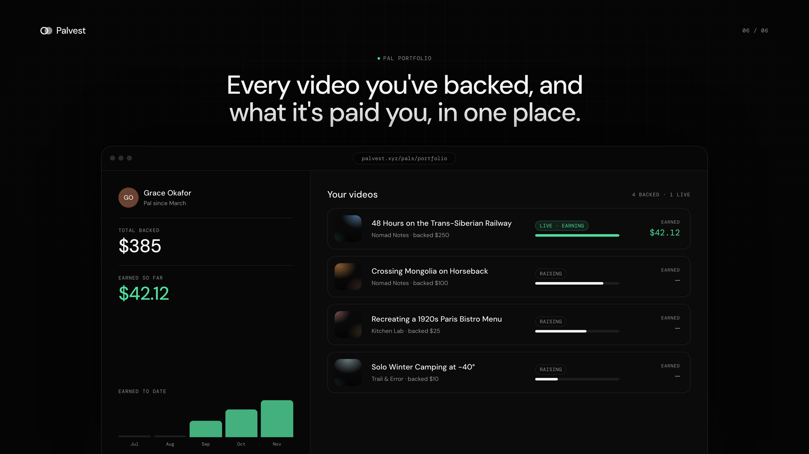

# Palvest: developer guide

**Invest in your favorite creators.** Fans back a creator's next project before it's made, and share in what it earns. Creators propose a video, raise the budget from their Pals, and share a percentage of its eligible revenue back with them.



<table>
  <tr>
    <td></td>
    <td></td>
  </tr>
  <tr>
    <td></td>
    <td></td>
  </tr>
  <tr>
    <td colspan="2"></td>
  </tr>
</table>

## Features

1. **AI-drafted pitches.** Describe the video you've always wanted to make, and Palvest writes the pitch: title, budget breakdown and Pal terms.
2. **Data-backed forecasts.** Expected views come from the channel's own last 20 long-form uploads, weighted toward similar videos. AI never touches the numbers.
3. **Fan backing.** Fans back the next video before it's shot, from $5, through PayPal.
4. **Earnings simulator.** Pals see what they could earn at any view count before they put in a dollar.
5. **Transparent payouts.** Revenue is split pro rata to the cent and sent as a PayPal Payouts batch.
6. **Pal portfolio.** Every video a Pal has backed, its status and what it has paid them, in one place.

## Routes

One Next.js 16 app, two modes:

| Route | What it does |
|---|---|
| `/` | Landing page: how it works, live simulations, projects raising now |
| `/creator` | Onboarding: paste a YouTube channel → analyzed → redirected to `/creator/[handle]` |
| `/creator/[handle]` | Creator dashboard (e.g. `/creator/veritasium`, `/creator/nomad-notes`): channel analysis, editable RPM, funding simulator, proposals |
| `/creator/[handle]/new-proposal` | Describe an idea → Claude drafts an editable proposal and picks comparable videos; code computes the forecast |
| `/creator/[handle]/projects/[id]` | Funding progress, Pals, mark published, live views / 90-day simulation, distribute revenue via PayPal Payouts |
| `/pals` | Marketplace |
| `/pals/[id]` | Proposal detail, forecast, track record, budget, back with PayPal Sandbox |
| `/pals/portfolio` | Videos backed, revenue received, revenue owed |
| `/showcase/1` … `/showcase/6` | 1920×1080 feature frames used for the images above (not indexed) |

No user accounts: the creator comes from the URL (their YouTube handle) and the Pal from a cookie. Use the switchers in the sidebar and nav. A real PayPal checkout switches you to that payer automatically. The creator side (`/creator` and its APIs) sits behind one shared password, `CREATOR_PASSWORD`, entered at `/unlock`. Leave it empty to turn the gate off. Pal pages and checkout stay public.

## Stack

Next.js 16 (App Router, Cache Components) · Tailwind v4 + shadcn/ui · Supabase Postgres (via `postgres`) · YouTube Data API v3 · Claude (`claude-opus-5-5`, structured outputs) · PayPal Orders v2 + Payouts v1 (Sandbox) · Vercel.

## Setup

```bash
pnpm install
cp .env.example .env.local   # fill in the keys below
pnpm db:setup                # creates tables + loads demo seed data
pnpm dev
```

### Keys

1. **Database.** Create a Supabase project, then copy *Project Settings → Database → Connection string → Transaction pooler* into `DATABASE_URL`. Any Postgres works locally, e.g. `postgres://you@localhost:5432/palvest`. To use the SQL editor instead, run `pnpm db:sql` and paste `db/schema.sql`. Then hit **Reset demo data** in the creator sidebar to seed.
2. **YouTube.** In Google Cloud Console, enable *YouTube Data API v3*, create an API key, and set `YOUTUBE_API_KEY`.
3. **Claude.** Set `ANTHROPIC_API_KEY`. Proposal drafting uses `claude-opus-5-5` at low effort, with server-side refusal fallbacks enabled.
4. **PayPal Sandbox.** At developer.paypal.com, create a REST app under *Apps & Credentials* in Sandbox mode. Copy the client ID into both `PAYPAL_CLIENT_ID` and `NEXT_PUBLIC_PAYPAL_CLIENT_ID`, and the secret into `PAYPAL_CLIENT_SECRET`. Make sure **Payouts** is enabled on the app. Check out with a *Personal* sandbox account from *Testing Tools → Sandbox Accounts*.

Secrets are only read server-side; only the PayPal client ID is public.

### Deploy (Vercel)

Import the repo, add the same env vars (set `NEXT_PUBLIC_APP_URL` to the deployment URL), and deploy. Run `pnpm db:setup` once against the production `DATABASE_URL`.

## How the money and numbers work

- **Forecast.** Deterministic (`src/lib/finance.ts`). Low/base/high come from the p25/median/p75 views of the last 20 mature long-form uploads (Shorts ≤60s excluded). If Claude picked comparables: `base = 0.65·median(comparables) + 0.35·median(all)`, keeping the channel's own spread. Revenue is `views / 1000 × RPM`, where RPM is editable.
- **Backing.** `POST /api/paypal/orders` creates the order plus a *pending* backing. `POST /api/paypal/orders/[id]/capture` captures it and only counts the backing once PayPal reports `COMPLETED` for the expected amount and proposal. Capture is idempotent. If the JS SDK popup can't load, a redirect checkout uses the same endpoints.
- **Settlement.** Pal pool = eligible revenue × share% × min(1, raised/target). Distributing first writes an auditable ledger: one line per Pal, pro rata, split in whole cents with the largest-remainder method so lines sum exactly to the pool. It then sends a PayPal Payouts batch. *Refresh status* pulls batch and item statuses back. Without PayPal credentials the ledger is still recorded (`ledger_only`) and can be sent later.

## 3-minute demo

1. `/creator`: paste a real channel (e.g. `youtube.com/@veritasium`) → lands on `/creator/veritasium` with live analysis; edit the RPM, play with the simulator.
2. **Start proposal**: type the idea plus `$4,000` → **Build my proposal**. Tweak anything, then **Publish proposal**.
3. **Open Pal page** → back `$10` with the PayPal Sandbox buyer. Funding progress updates from the server-confirmed capture.
4. Sidebar switcher → **Nomad Notes** (`/creator/nomad-notes`) → *48 Hours on the Trans-Siberian Railway*: 842,390 views, $3,369.56 revenue, 20% → **$673.91 owed**.
5. **Distribute $673.91 to Pals** → ledger across 84 Pals plus the PayPal Payouts batch ID.
6. `/pals/portfolio` as *Alex Rivera*: the $10 backer received their share.

**Reset demo data** in the creator sidebar restores the seed at any time.

## Feature images

The PNGs in `showcase-images/` are screenshots of `/showcase/1`–`/showcase/6`. Each frame is a single sentence over a static mock, using the same demo data as the homepage. To change a slide, edit the `SLIDES` array in `src/components/showcase/slides.tsx`. To re-shoot, run `pnpm dev`, then for each frame screenshot the `#showcase-frame` element at a 1920×1080 viewport. At `deviceScaleFactor: 2` (e.g. with Playwright), that gives 3840×2160 PNGs.

Returns aren't guaranteed and Pals don't own the video or the creator's company. This is a hackathon prototype on PayPal Sandbox.
